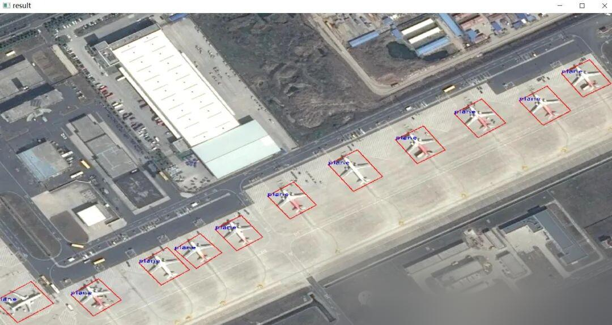

# [C++] deploying rotational bounding box target detection using pure OpenCV

[Official Framework Address]

GitHub - ultralytics/ultralytics: Ultralytics YOLO11 🚀
[Algorithm introduction]

YOLOv11 is an advanced object detection algorithm that achieves rapid object detection through a single neural network. Among its features, rotational box detection is a significant aspect of YOLOv11, enabling the effective detection of objects in various orientations and angles.

The principle of rotation box detection is achieved through predicting the object's bounding box and rotation angle. In YOLOv11, the neural network not only predicts the position of the object's bounding box but also predicts the rotation angle. This means that YOLOv11 can detect objects in different directions and angles, not just those facing forward.

Through the use of rotational boxes, YOLOv11 demonstrates greater flexibility in handling challenging object detection tasks. For instance, when dealing with images that contain objects at different orientations and angles, rotational box detection can provide more accurate detection results. Additionally, for certain objects with unique shapes, rotational box detection can also yield better results.

However, rotation box detection also poses some challenges. Firstly, predicting the rotation angle requires more computational resources. Secondly, since the direction and angle of an object can vary with the image's orientation or the camera's perspective, it is necessary to train the model with more accurate training data. Additionally, as rotation box detection involves the prediction of multiple parameters, a more robust neural network architecture is required to handle these parameters.

Overall, the rotational bounding box detection of YOLOv11 is a powerful technology that can enhance the accuracy and flexibility of object detection. Despite the challenges it brings, through continuous research and innovation, we can overcome these challenges and further improve the performance of object detection.

[Effect Display]


[Implementation of Partial Code]

-
-
-
-
-
-
-
-
-
-
-
-
-
-
-
-
-
-
-
-
-
-
-
-

```
#include <iostream>#include<opencv2/opencv.hpp>#include"Yolov11ObbManager.h" using namespace std; using namespace cv; // Please note that if the input width and height of your own Onnx model are 640, you need to change the four places in Yolov11ObbManager.cpp to 640, which are 32 lines, 42 lines, and 43 lines respectively. The source code is still `int main() { Yolov11ObbManager detector;` detector.LoadWeights("E:\\official-model\\yolov11\\yolo11n-obb.onnx","C:\\Users\\Administrator\\Desktop\\00\\yolov11-obb-onnx-cplus\\labels.txt"); cv::Mat image=cv::imread("C:\\Users\\Administrator\\Desktop\\00\\yolov11-obb-onnx-cplus\\P0032.png"); auto res = detector.Inference(image); detector.DrawImage(image,res); cv::namedWindow("result", cv::WINDOW_KEEPRATIO); cv::imshow("result", image); cv::waitKey(0); return 0; }
```

[Video demonstration]

C++ deploys Yolov11 rotation box object detection using pure OpenCV on BiliBili [Test Environment] vs2019 cmake==3.24.3 opencv==4.8.0 for more information and source code download refer to the blog: https://blog.csdn.net/FL1623863129/article/details/142712173, video play count 0, comment count 0, like count 0, coin count 0, collection count 0, forward count 0, video author Future Autonomous Research Center, author's biography Future Autonomous Research Center, related videos:https://www.bilibili.com/video/BV1LG1QYdE7x/
[Source Code Download]


## Payment

Here is a pay link on Stripe ( https://buy.stripe.com/3cs8yP7sY87d0vu9AB ). Please contact me lonlonago@foxmail.com after funding $89, and I will send you a complete data files , thank you!


